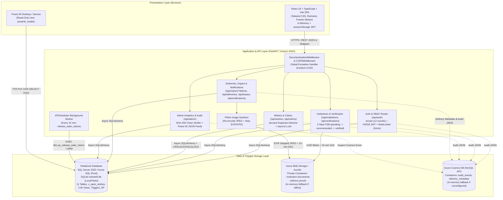
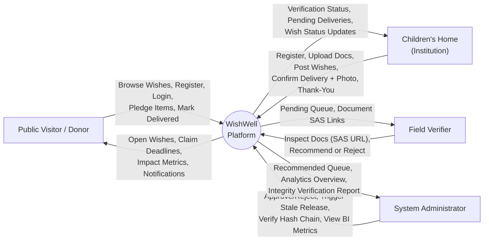
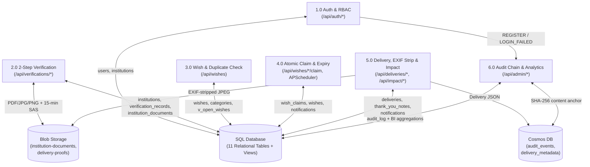
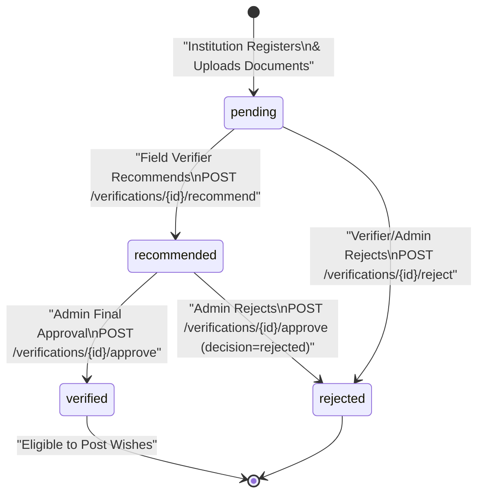
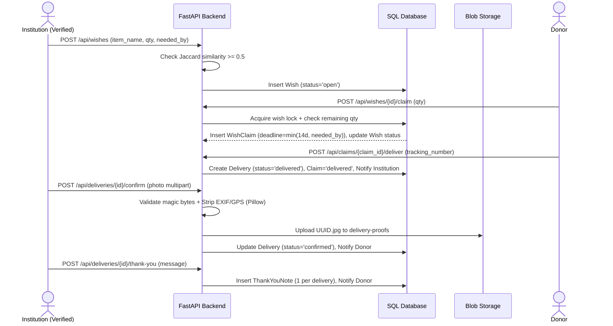

# WishWell — System Architecture Documentation

> **Document Scope:** Verified architectural blueprint derived strictly from the actual source code in the WishWell repository (`backend/`, `frontend/`, `db/`, `infra/`).  
> **Related Documents:** [technical_documentation.md](./technical_documentation.md) | [database_documentation.md](./database_documentation.md) | [api_documentation.md](./api_documentation.md) | [security_documentation.md](./security_documentation.md)

---

## 1. Architectural Overview

WishWell is a full-stack, multi-tier web platform designed to connect verified children's homes (institutions) with physical-item donors through transparent, auditable fulfillment workflows. Its architecture separates presentation, asynchronous REST API logic, relational ACID persistence, private binary object storage, and optional semi-structured NoSQL telemetry.

### Deployment Modes Supported in the Repository
1. **Local Standalone Mode (Active Default in `.env`)**: FastAPI (`uvicorn`) connects asynchronously via `sqlite+aiosqlite` to `wishwell.db`, with automatic in-memory fallbacks in `StorageService` and `CosmosService` when Azurite/Azure Blob or Cosmos DB are unconfigured.
2. **Local Containerized Mode (`docker-compose.yml`)**: FastAPI connects via `mssql+aioodbc` (ODBC Driver 18) to Microsoft SQL Server 2022 (`localhost:1433`) and Azurite Blob Emulator (`localhost:10000`).
3. **Cloud Production Mode (`infra/deploy.ps1`, `infra/deploy.sh`)**: React SPA on Azure Static Web Apps (or Netlify via `netlify.toml`), FastAPI on Azure App Service (Linux Python 3.11), Azure SQL Database Serverless, Azure Blob Storage, Azure Key Vault, and Azure Cosmos DB (Serverless NoSQL).

---

## 2. Overall System Architecture Diagram

---

## 3. Frontend–Backend–Database Interaction

### 3.1 Request Lifecycle
1. **Frontend Routing & State (`frontend/src/App.tsx`, `AuthContext.tsx`)**:
   - Uses a hash/path router (`normalizeRoute`) inside `App.tsx` supporting public views (`/`, `/browse`, `/login`) and role-guarded views (`/donor/*`, `/institution/*`, `/verifier/queue`, `/admin/*`).
   - Stores JWT bearer tokens in memory (`_inMemoryToken` in `frontend/src/api/client.ts`) synchronized with `sessionStorage` (`wishwell_session_token`).
2. **Typed API Client (`frontend/src/api/client.ts`, `endpoints.ts`)**:
   - Prepends `VITE_API_BASE` (defaulting to `http://localhost:8000/api`; Vite dev server also proxies `/api` to `http://localhost:8000`).
   - Attaches `Authorization: Bearer <token>` and maps HTTP `409 Conflict` responses to typed `DuplicateWishError` or `OverClaimError` exceptions.
3. **FastAPI Middleware & Dependency Injection (`backend/app/main.py`, `dependencies.py`)**:
   - `SecurityHeadersMiddleware` injects `X-Content-Type-Options`, `X-Frame-Options`, `X-XSS-Protection`, `Referrer-Policy`, `Permissions-Policy`, `Content-Security-Policy`, and `Strict-Transport-Security` (when `ENVIRONMENT != "development"`).
   - `CORSMiddleware` enforces allowed origins from `settings.CORS_ORIGINS`.
   - `require_role(*roles)` validates the JWT, fetches the `User` row from SQL via `get_db()`, and rejects unauthorized roles with HTTP `403`.
4. **Database & Polyglot Persistence (`database.py`, `audit.py`, `cosmos.py`, `storage.py`)**:
   - SQLAlchemy 2.0 `AsyncSession` executes parameterized queries against MSSQL (`aioodbc`) or SQLite (`aiosqlite`).
   - State-changing actions call `record_audit_event()`, which hashes the payload (and optional Cosmos DB canonical JSON hash) into `dbo.audit_log`.

---

## 4. Data Flow Diagrams (DFD)

### 4.1 Level 0 — Context Data Flow Diagram

### 4.2 Level 1 — Core Wish Fulfillment & Audit Data Flow

---

## 5. Role-Based Workflow Diagrams

### 5.1 Two-Step Institution Verification State Machine

### 5.2 Wish, Claim & Delivery Fulfillment Lifecycle

