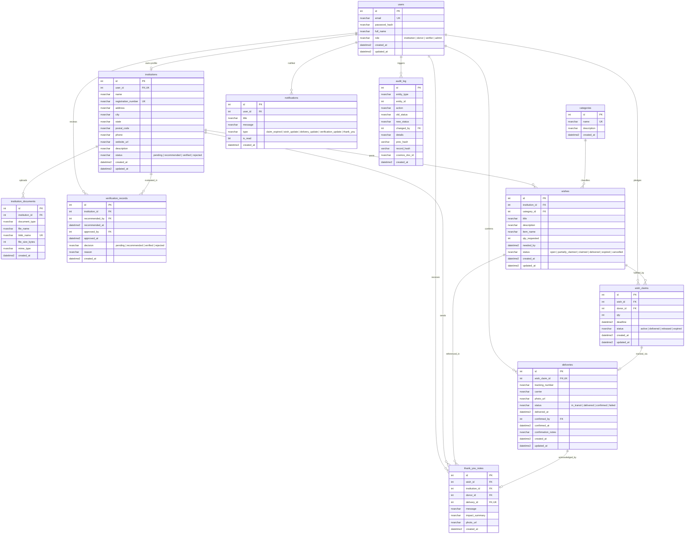

# WishWell — Database Documentation

> **Document Scope:** Complete relational and NoSQL schema documentation verified against `db/schema.sql`, `backend/app/models/entities.py`, `scripts/init_local_db.py`, `db/seed.sql`, and `db/seed_analytics.sql`.  
> **Related Documents:** [architecture.md](./architecture.md) | [technical_documentation.md](./technical_documentation.md) | [docs/3NF_ANALYSIS.md](../3NF_ANALYSIS.md)

---

## 1. Database Engines & Dual-Target Compatibility

| Environment | Engine / Driver | Schema Source | Notes |
|---|---|---|---|
| **Production / Docker** | Microsoft SQL Server 2022 / Azure SQL (`mssql+aioodbc`, `mssql+pyodbc`, ODBC Driver 18/17) | `db/schema.sql`, `db/seed.sql`, `db/seed_analytics.sql` | Full T-SQL support: `IDENTITY(1,1)`, `DATETIME2(7)`, `OUTER APPLY`, 6 triggers, stored procedure `dbo.sp_release_stale_claims`, 6 views, contained users `wishwell_app` & `powerbi_reader`. |
| **Local Demo (`wishwell.db`)** | SQLite 3 (`sqlite+aiosqlite`) | `scripts/init_local_db.py` + SQLAlchemy ORM `Base.metadata` | Creates all 11 tables, SQLite view `v_open_wishes`, and trigger `trg_wish_claims_enforce_active_qty_limit` (AFTER INSERT). Stale-claim expiry and audit hashing run in Python (`scheduler.py`, `audit.py`). |
| **Automated Tests** | In-memory SQLite (`sqlite+aiosqlite`) | `backend/tests/conftest.py` | Creates all 11 tables, `v_open_wishes`, `trg_wish_claims_enforce_active_qty_limit`, and `trg_audit_log_prevent_update` / `trg_audit_log_prevent_delete`. |
| **Polyglot NoSQL (Optional)** | Azure Cosmos DB (Core/SQL API) | `backend/app/core/cosmos.py`, `infra/deploy.ps1` | Containers `audit_events` (PK `/entity`) and `delivery_metadata` (PK `/claim_id`), with in-memory dictionary fallback when unconfigured. |

---

## 2. Entity-Relationship (ER) Diagram

---

## 3. Complete Table Specifications (`db/schema.sql`)

### 3.1 `dbo.users`
Stores authentication identities across all four platform roles.

| Column | Type | Null | Constraints / Defaults | Description |
|---|---|---|---|---|
| `id` | `INT IDENTITY(1,1)` | NO | `PRIMARY KEY` | Surrogate primary key |
| `email` | `NVARCHAR(255)` | NO | `UNIQUE (UQ_users_email)` | Unique login email |
| `password_hash` | `NVARCHAR(255)` | NO | — | Salted bcrypt hash (12 rounds) |
| `full_name` | `NVARCHAR(150)` | NO | — | Display name |
| `role` | `NVARCHAR(20)` | NO | `CHECK (role IN ('institution', 'donor', 'verifier', 'admin'))` | RBAC role |
| `created_at` | `DATETIME2(7)` | NO | `DEFAULT SYSUTCDATETIME()` | UTC creation time |
| `updated_at` | `DATETIME2(7)` | NO | `DEFAULT SYSUTCDATETIME()` | UTC update time |

### 3.2 `dbo.institutions`
Stores children's home profiles in a 1-to-1 relationship with an `institution` user.

| Column | Type | Null | Constraints / Defaults | Description |
|---|---|---|---|---|
| `id` | `INT IDENTITY(1,1)` | NO | `PRIMARY KEY` | Surrogate primary key |
| `user_id` | `INT` | NO | `UNIQUE`, `FK -> dbo.users(id) ON DELETE CASCADE` | Owning user |
| `name` | `NVARCHAR(200)` | NO | — | Official institution name |
| `registration_number` | `NVARCHAR(100)` | NO | `UNIQUE (UQ_institutions_reg_no)` | Government/NGO registration ID |
| `address` | `NVARCHAR(500)` | NO | — | Street address |
| `city` | `NVARCHAR(100)` | NO | — | City |
| `state` | `NVARCHAR(100)` | NO | — | State/province |
| `postal_code` | `NVARCHAR(20)` | NO | — | Postal/ZIP code |
| `phone` | `NVARCHAR(30)` | NO | — | Contact phone |
| `website_url` | `NVARCHAR(255)` | YES | — | Optional website |
| `description` | `NVARCHAR(1000)` | YES | — | Mission/facility summary |
| `status` | `NVARCHAR(20)` | NO | `DEFAULT 'pending'`, `CHECK (status IN ('pending','recommended','verified','rejected'))` | Verification FSM state |
| `created_at` | `DATETIME2(7)` | NO | `DEFAULT SYSUTCDATETIME()` | Creation timestamp |
| `updated_at` | `DATETIME2(7)` | NO | `DEFAULT SYSUTCDATETIME()` | Update timestamp |

### 3.3 `dbo.institution_documents`
Metadata for legal compliance documents stored privately in Azure Blob Storage / Azurite.

| Column | Type | Null | Constraints / Defaults | Description |
|---|---|---|---|---|
| `id` | `INT IDENTITY(1,1)` | NO | `PRIMARY KEY` | Surrogate key |
| `institution_id` | `INT` | NO | `FK -> dbo.institutions(id) ON DELETE CASCADE` | Parent institution |
| `document_type` | `NVARCHAR(50)` | NO | `CHECK (document_type IN ('registration_certificate','license','tax_exemption','premises_lease','audit_report','other'))` | Document category |
| `file_name` | `NVARCHAR(255)` | NO | — | Original filename |
| `blob_name` | `NVARCHAR(255)` | NO | `UNIQUE (UQ_institution_documents_blob)` | UUID blob key in storage |
| `file_size_bytes` | `INT` | NO | — | Size in bytes (max 5 MB in API) |
| `mime_type` | `NVARCHAR(100)` | NO | — | Validated MIME type (`application/pdf`, `image/png`, `image/jpeg`) |
| `created_at` | `DATETIME2(7)` | NO | `DEFAULT SYSUTCDATETIME()` | Upload timestamp |

### 3.4 `dbo.verification_records`
Records each step of the two-step inspection and approval workflow.

| Column | Type | Null | Constraints / Defaults | Description |
|---|---|---|---|---|
| `id` | `INT IDENTITY(1,1)` | NO | `PRIMARY KEY` | Surrogate key |
| `institution_id` | `INT` | NO | `FK -> dbo.institutions(id) ON DELETE CASCADE` | Reviewed institution |
| `recommended_by` | `INT` | YES | `FK -> dbo.users(id)` | Field verifier user ID |
| `recommended_at` | `DATETIME2(7)` | YES | — | Step-1 timestamp |
| `approved_by` | `INT` | YES | `FK -> dbo.users(id)` | Admin user ID |
| `approved_at` | `DATETIME2(7)` | YES | — | Step-2 timestamp |
| `decision` | `NVARCHAR(20)` | NO | `CHECK (decision IN ('pending','recommended','verified','rejected'))` | Recorded decision |
| `reason` | `NVARCHAR(1000)` | NO | — | Inspection/approval notes |
| `created_at` | `DATETIME2(7)` | NO | `DEFAULT SYSUTCDATETIME()` | Record timestamp |

### 3.5 `dbo.categories`
3NF lookup table for physical item categories.

| Column | Type | Null | Constraints / Defaults | Description |
|---|---|---|---|---|
| `id` | `INT IDENTITY(1,1)` | NO | `PRIMARY KEY` | Category ID |
| `name` | `NVARCHAR(100)` | NO | `UNIQUE (UQ_categories_name)` | Category name |
| `description` | `NVARCHAR(500)` | YES | — | Category description |
| `created_at` | `DATETIME2(7)` | NO | `DEFAULT SYSUTCDATETIME()` | Creation timestamp |

### 3.6 `dbo.wishes`
Item requests created by verified children's homes.

| Column | Type | Null | Constraints / Defaults | Description |
|---|---|---|---|---|
| `id` | `INT IDENTITY(1,1)` | NO | `PRIMARY KEY` | Wish ID |
| `institution_id` | `INT` | NO | `FK -> dbo.institutions(id) ON DELETE CASCADE` | Requesting institution |
| `category_id` | `INT` | NO | `FK -> dbo.categories(id)` | Item category |
| `title` | `NVARCHAR(200)` | NO | — | Wish headline |
| `description` | `NVARCHAR(1000)` | NO | — | Need context (2000 chars in Pydantic `WishBase`) |
| `item_name` | `NVARCHAR(150)` | NO | — | Normalized target item name |
| `qty_requested` | `INT` | NO | `CHECK (qty_requested > 0)` | Requested unit count |
| `needed_by` | `DATETIME2(7)` | NO | — | Target fulfillment deadline |
| `status` | `NVARCHAR(20)` | NO | `DEFAULT 'open'`, `CHECK (status IN ('open','partially_claimed','claimed','delivered','expired','cancelled'))` | Fulfillment state |
| `created_at` | `DATETIME2(7)` | NO | `DEFAULT SYSUTCDATETIME()` | Creation timestamp |
| `updated_at` | `DATETIME2(7)` | NO | `DEFAULT SYSUTCDATETIME()` | Update timestamp |

### 3.7 `dbo.wish_claims`
Donor pledges against open or partially claimed wishes.

| Column | Type | Null | Constraints / Defaults | Description |
|---|---|---|---|---|
| `id` | `INT IDENTITY(1,1)` | NO | `PRIMARY KEY` | Claim ID |
| `wish_id` | `INT` | NO | `FK -> dbo.wishes(id) ON DELETE CASCADE` | Target wish |
| `donor_id` | `INT` | NO | `FK -> dbo.users(id)` | Pledging donor |
| `qty` | `INT` | NO | `CHECK (qty > 0)` | Claimed quantity |
| `deadline` | `DATETIME2(7)` | NO | — | Fulfillment deadline (`min(now+14d, needed_by)`) |
| `status` | `NVARCHAR(20)` | NO | `DEFAULT 'active'`, `CHECK (status IN ('active','delivered','released','expired'))` | Claim state |
| `created_at` | `DATETIME2(7)` | NO | `DEFAULT SYSUTCDATETIME()` | Creation timestamp |
| `updated_at` | `DATETIME2(7)` | NO | `DEFAULT SYSUTCDATETIME()` | Update timestamp |

### 3.8 `dbo.deliveries`
1-to-1 delivery tracking and item-only photo proof record for a claim.

| Column | Type | Null | Constraints / Defaults | Description |
|---|---|---|---|---|
| `id` | `INT IDENTITY(1,1)` | NO | `PRIMARY KEY` | Delivery ID |
| `wish_claim_id` | `INT` | NO | `UNIQUE`, `FK -> dbo.wish_claims(id) ON DELETE CASCADE` | Associated claim |
| `tracking_number` | `NVARCHAR(100)` | YES | — | Courier tracking number |
| `carrier` | `NVARCHAR(100)` | YES | — | Carrier name |
| `photo_url` | `NVARCHAR(500)` | YES | — | UUID blob name in `delivery-proofs` |
| `status` | `NVARCHAR(20)` | NO | `DEFAULT 'in_transit'`, `CHECK (status IN ('in_transit','delivered','confirmed','failed'))` | Delivery state |
| `delivered_at` | `DATETIME2(7)` | YES | — | Donor dispatch timestamp |
| `confirmed_by` | `INT` | YES | `FK -> dbo.users(id)` | Confirming institution user |
| `confirmed_at` | `DATETIME2(7)` | YES | — | Confirmation timestamp |
| `confirmation_notes` | `NVARCHAR(1000)` | YES | — | Optional receipt notes |
| `created_at` | `DATETIME2(7)` | NO | `DEFAULT SYSUTCDATETIME()` | Creation timestamp |
| `updated_at` | `DATETIME2(7)` | NO | `DEFAULT SYSUTCDATETIME()` | Update timestamp |

### 3.9 `dbo.thank_you_notes`
1-to-1 gratitude message linked to a confirmed delivery.

| Column | Type | Null | Constraints / Defaults | Description |
|---|---|---|---|---|
| `id` | `INT IDENTITY(1,1)` | NO | `PRIMARY KEY` | Note ID |
| `wish_id` | `INT` | NO | `FK -> dbo.wishes(id)` | Related wish |
| `institution_id` | `INT` | NO | `FK -> dbo.institutions(id)` | Authoring institution |
| `donor_id` | `INT` | NO | `FK -> dbo.users(id)` | Recipient donor |
| `delivery_id` | `INT` | NO | `UNIQUE`, `FK -> dbo.deliveries(id)` | Enforces 1 note per delivery |
| `message` | `NVARCHAR(MAX)` | NO | — | Thank-you message |
| `impact_summary` | `NVARCHAR(1000)` | YES | — | Impact summary |
| `photo_url` | `NVARCHAR(500)` | YES | — | Copied proof blob name |
| `created_at` | `DATETIME2(7)` | NO | `DEFAULT SYSUTCDATETIME()` | Creation timestamp |

### 3.10 `dbo.notifications`
In-app alerts for expirations, dispatches, confirmations, and thank-you notes.

| Column | Type | Null | Constraints / Defaults | Description |
|---|---|---|---|---|
| `id` | `INT IDENTITY(1,1)` | NO | `PRIMARY KEY` | Notification ID |
| `user_id` | `INT` | NO | `FK -> dbo.users(id) ON DELETE CASCADE` | Target user |
| `title` | `NVARCHAR(200)` | NO | — | Alert title |
| `message` | `NVARCHAR(1000)` | NO | — | Alert body |
| `type` | `NVARCHAR(50)` | NO | `CHECK (type IN ('claim_expired','wish_update','delivery_update','verification_update','thank_you'))` | Alert category |
| `is_read` | `BIT` | NO | `DEFAULT 0` | Read indicator |
| `created_at` | `DATETIME2(7)` | NO | `DEFAULT SYSUTCDATETIME()` | Creation timestamp |

### 3.11 `dbo.audit_log`
Append-only cryptographic ledger capturing state transitions and anchoring Cosmos DB documents.

| Column | Type | Null | Constraints / Defaults | Description |
|---|---|---|---|---|
| `id` | `INT IDENTITY(1,1)` | NO | `PRIMARY KEY` | Sequential block ID |
| `entity_type` | `NVARCHAR(50)` | NO | — | Entity/table name |
| `entity_id` | `INT` | NO | — | Target record ID |
| `action` | `NVARCHAR(50)` | NO | — | Action label (e.g., `REGISTER`, `CLAIM_CREATED`, `STATUS_CHANGE`) |
| `old_status` | `NVARCHAR(50)` | YES | — | Previous state |
| `new_status` | `NVARCHAR(50)` | YES | — | New state |
| `changed_by` | `INT` | YES | `FK -> dbo.users(id)` | Actor user ID |
| `details` | `NVARCHAR(MAX)` | YES | — | Human-readable summary |
| `prev_hash` | `VARCHAR(64)` | YES | — | Previous block SHA-256 (or 64 `'0'`s for genesis) |
| `record_hash` | `VARCHAR(64)` | YES | — | SHA-256 of canonical string + Cosmos content hash |
| `cosmos_doc_id` | `NVARCHAR(100)` | YES | — | Linked Cosmos DB `audit_events` document UUID |
| `created_at` | `DATETIME2(7)` | NO | `DEFAULT SYSUTCDATETIME()` | Event timestamp |

---

## 4. Normalization (3NF) Summary

WishWell's schema satisfies **Third Normal Form (3NF)** (detailed proofs in [docs/3NF_ANALYSIS.md](../3NF_ANALYSIS.md)):
1. **1NF**: All attributes are atomic scalars (`NVARCHAR`, `INT`, `DATETIME2`, `BIT`). Partial pledges and multiple verification steps are modeled as separate rows in `wish_claims` and `verification_records`.
2. **2NF**: Every table uses a single-column surrogate key (`id`), eliminating composite-key partial dependencies.
3. **3NF**: Non-key attributes depend exclusively on the primary key:
   - `institutions` is separated from `users` so donor/admin rows carry no institutional columns.
   - `categories` eliminates repeated category descriptions inside `wishes`.
   - `qty_remaining` is **not stored** in `wishes` (avoiding derived-column update anomalies); it is dynamically computed by `dbo.v_open_wishes` via `OUTER APPLY`.
   - `deliveries` and `thank_you_notes` are separated from `wish_claims` because delivery logistics and gratitude notes apply only to fulfilled pledges.

---

## 5. Database Indexes, Views, Triggers, and Stored Procedures

### 5.1 Indexes (`db/schema.sql`)
- `idx_wishes_status_needed_by` on `dbo.wishes(status, needed_by)`
- `idx_wishes_category_id` on `dbo.wishes(category_id)`
- `idx_wishes_institution_id` on `dbo.wishes(institution_id)`
- `idx_wish_claims_donor_id` on `dbo.wish_claims(donor_id)`
- `idx_wish_claims_wish_id` on `dbo.wish_claims(wish_id)`
- `idx_wish_claims_status_deadline` on `dbo.wish_claims(status, deadline)`
- `idx_audit_log_created_at` on `dbo.audit_log(created_at)`
- `idx_notifications_user_unread` on `dbo.notifications(user_id, is_read) INCLUDE (created_at)`

### 5.2 SQL Views (6 Views)
1. **`dbo.v_open_wishes`**: Joins `wishes`, `categories`, and `institutions` using `OUTER APPLY` on `wish_claims` (`status = 'active'`) to compute `qty_claimed` and `qty_remaining`, filtered to `w.status IN ('open', 'partially_claimed')`, `w.needed_by > SYSUTCDATETIME()`, and `i.status = 'verified'`.
2. **`dbo.vw_wishes_by_category_month`**: Monthly count of wishes posted vs. fulfilled and item totals by category.
3. **`dbo.vw_avg_delivery_time`**: Average, minimum, and maximum hours/days from claim creation to confirmed delivery (`d.status = 'confirmed'`).
4. **`dbo.vw_institutions_by_status`**: Verification funnel counts and percentage share per status using `SUM(COUNT(*)) OVER()`.
5. **`dbo.vw_stale_claim_rate`**: Monthly claim counts across `active`, `delivered`, `released`, and `expired` with `stale_claim_rate_pct`.
6. **`dbo.vw_top_categories`**: Category demand ranking (`DENSE_RANK()`) and fulfillment rate percentages.

### 5.3 T-SQL Triggers (8 Triggers)
| Trigger | Table & Event | Purpose |
|---|---|---|
| `trg_audit_log_prevent_mutation` | `dbo.audit_log` (`INSTEAD OF UPDATE, DELETE`) | Blocks any update or deletion on the audit ledger, raising error and rolling back. |
| `trg_wishes_check_needed_by_future` | `dbo.wishes` (`AFTER INSERT`) | Enforces `needed_by > SYSUTCDATETIME()` (impossible in T-SQL `CHECK` due to non-determinism). |
| `trg_wishes_enforce_verified_institution` | `dbo.wishes` (`AFTER INSERT`) | Blocks wish insertion unless the owning institution has `status = 'verified'`. |
| `trg_wish_claims_enforce_active_qty_limit` | `dbo.wish_claims` (`AFTER INSERT, UPDATE`) | Rolls back if `SUM(active qty) > qty_requested`, and auto-syncs `wishes.status` (`open`, `partially_claimed`, `claimed`). |
| `trg_institutions_status_audit` | `dbo.institutions` (`AFTER UPDATE`) | Inserts `STATUS_CHANGE` row into `audit_log` when `status` changes. |
| `trg_wishes_status_audit` | `dbo.wishes` (`AFTER UPDATE`) | Inserts `STATUS_CHANGE` row into `audit_log` when `status` changes. |
| `trg_wish_claims_status_audit` | `dbo.wish_claims` (`AFTER UPDATE`) | Inserts `STATUS_CHANGE` row into `audit_log` when `status` changes. |
| `trg_deliveries_status_audit` | `dbo.deliveries` (`AFTER UPDATE`) | Inserts `STATUS_CHANGE` row into `audit_log` when `status` changes. |

### 5.4 Stored Procedure: `dbo.sp_release_stale_claims`
Executes inside a single `BEGIN TRY ... BEGIN TRANSACTION ... COMMIT` block (`SET XACT_ABORT ON`):
1. Collects all `wish_claims` where `status = 'active'` and `deadline < SYSUTCDATETIME()` into `@expired_claims`.
2. Updates those claims to `status = 'expired'`.
3. Recalculates parent `wishes.status` (`open`, `partially_claimed`, or `claimed`) from remaining active claims.
4. Inserts `claim_expired` rows into `dbo.notifications` for every affected donor.
5. Returns `expired_claims_count`.

### 5.5 Least-Privilege Database Users (`infra/apply_sql.py`)
- **`wishwell_app`**: Granted `SELECT, INSERT, UPDATE, DELETE` on application tables, `SELECT` on `v_open_wishes`, `EXECUTE` on `sp_release_stale_claims`, **`SELECT, INSERT` only** on `dbo.audit_log`, and `DENY UPDATE, DELETE` on `dbo.audit_log`.
- **`powerbi_reader`**: Granted `SELECT` on the 5 analytics views, `v_open_wishes`, and core reporting tables, with `DENY INSERT, UPDATE, DELETE ON SCHEMA::dbo`.

---

## 6. Seed Datasets & NoSQL Containers

- **`db/seed.sql` (T-SQL)**: Seeds 1 admin, 1 verifier, 3 institutions (`verified`, `recommended`, `pending`), 4 donors, 6 categories, 15 wishes, 2 claims (1 active, 1 delivered/confirmed with thank-you note). Note: Institution 1 email in `seed.sql` is `contact@stmaryshaven.org`.
- **`scripts/init_local_db.py` (Local `wishwell.db`)**: Seeds both `contact@stmarys.org` and `contact@stmaryshaven.org`, 3 institutions, 4 donors, 6 categories, 4 wishes, 1 active claim, and 1 genesis `AuditLog` row.
- **`db/seed_analytics.sql`**: Disables validation/audit triggers temporarily to insert 6 months of historical analytics data (~300 wishes, 150 claims, 100 deliveries, 100 thank-you notes) and re-enables triggers afterward.
- **Cosmos DB (`backend/app/core/cosmos.py`)**:
  - `audit_events` (Partition Key: `/entity`): `{id, entity, entity_id, action, old_status, new_status, changed_by, details, created_at, metadata}`.
  - `delivery_metadata` (Partition Key: `/claim_id`): `{id, claim_id, delivery_id, status, tracking_number, carrier, photo_blob, confirmation_notes, timestamp, metadata}`.
