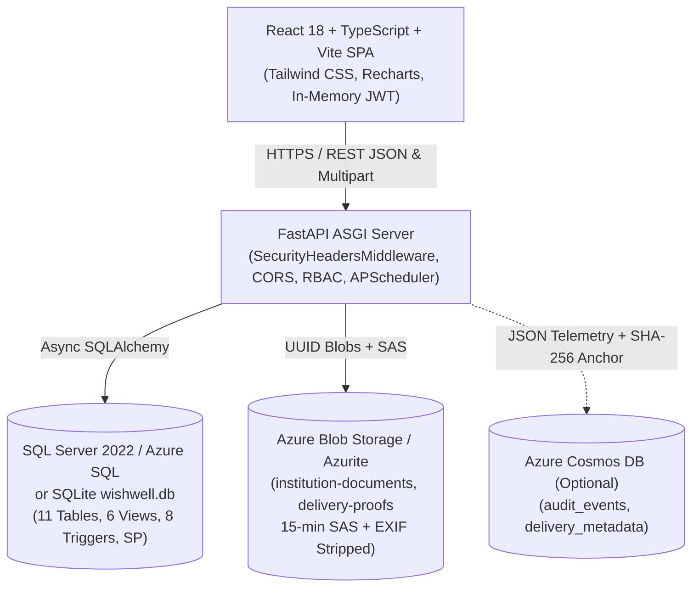
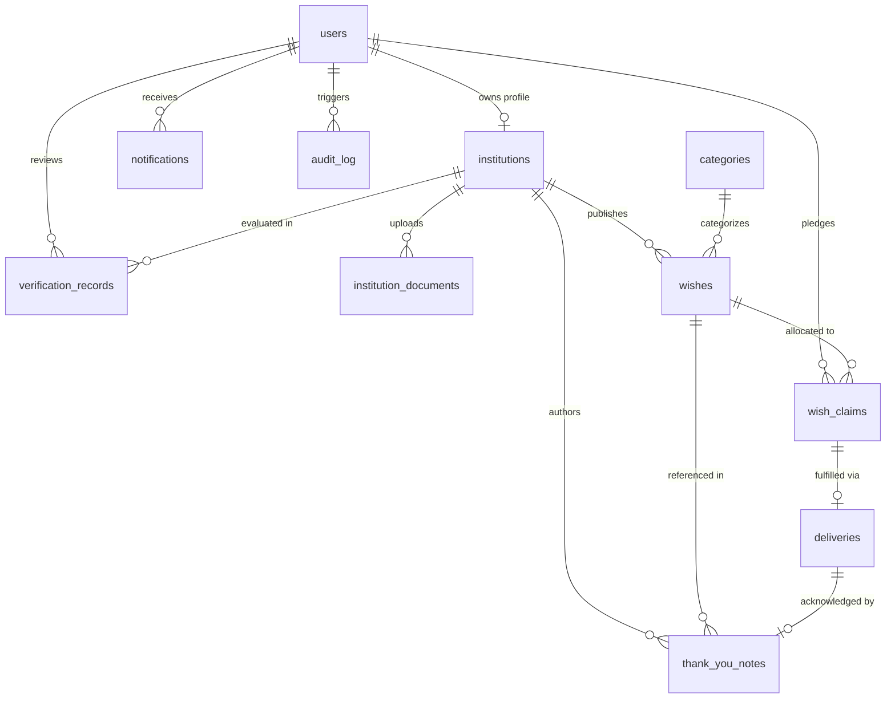
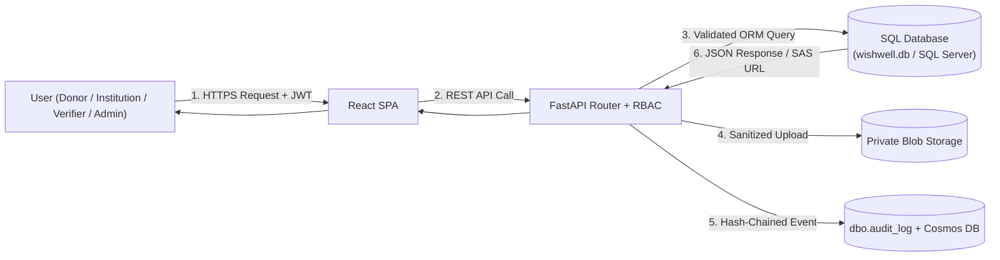

# WISHWELL — A VERIFIED WISH-MATCHING PLATFORM

---

## 1. Cover Page

**PROJECT TITLE:**  
**WishWell — A Verified Wish-Matching Platform for Direct, Transparent Item Fulfillment**

**Submitted in partial fulfillment of the requirements for the degree of**  
**Bachelor of Technology (B.Tech) in [DEPARTMENT_NAME]**

**Submitted By:**
- **[STUDENT_NAME_1]** — UID: `[UID_1]`
- **[STUDENT_NAME_2]** — UID: `[UID_2]`

**Under the Guidance of:**  
**[GUIDE_NAME]**, `[GUIDE_DESIGNATION]`

**Department:** `[DEPARTMENT_NAME]`  
**Institution / College:** `[COLLEGE_NAME]`  
**Academic Year:** `[ACADEMIC_YEAR]`

---

## 2. Certificate (Placeholder)

> **BONAFIDE CERTIFICATE**
>
> This is to certify that the project report entitled **"WishWell — A Verified Wish-Matching Platform"** is a bonafide work carried out by **[STUDENT_NAME_1] (`[UID_1]`)** and **[STUDENT_NAME_2] (`[UID_2]`)** under my supervision and guidance during the academic year **`[ACADEMIC_YEAR]`**, in partial fulfillment of the requirements for the award of the degree of **Bachelor of Technology in `[DEPARTMENT_NAME]`** at **`[COLLEGE_NAME]`**.
>
> | | |
> |---|---|
> | **Project Guide** | **Head of Department** |
> | `[GUIDE_NAME]` | `[HOD_NAME]` |
> | `[DEPARTMENT_NAME]` | `[DEPARTMENT_NAME]` |
> | Date: `[DATE]` | Seal & Signature |

---

## 3. Declaration

We hereby declare that the project work entitled **"WishWell — A Verified Wish-Matching Platform"** submitted to **`[COLLEGE_NAME]`** is a record of original work carried out by us under the guidance of **`[GUIDE_NAME]`**. All implementations, source code references, database schemas, and test execution results reported in this document reflect the actual codebase in our repository. External open-source libraries and AI-assisted development tools used during engineering and documentation are explicitly acknowledged.

| Student Name | UID | Signature |
|---|---|---|
| `[STUDENT_NAME_1]` | `[UID_1]` | `________________` |
| `[STUDENT_NAME_2]` | `[UID_2]` | `________________` |

Date: `[DATE]`  
Place: `[CITY]`

---

## 4. Acknowledgement

We express our sincere gratitude to **`[GUIDE_NAME]`** for their continuous mentorship, technical guidance, and constructive feedback throughout the design and implementation of WishWell. We also thank **`[HOD_NAME]`**, Head of the Department of **`[DEPARTMENT_NAME]`**, and the faculty members of **`[COLLEGE_NAME]`** for providing the academic environment and computing resources necessary for this project. Finally, we thank our peers and family for their encouragement and support.

---

## 5. Abstract

Charitable giving to residential children's homes frequently suffers from a **trust and transparency gap**: donors hesitate to contribute arbitrary cash pools without verifiable proof that funds purchase essential items, while genuine care homes struggle to coordinate physical supplies without exposing vulnerable children's identities or locations.

**WishWell** is a full-stack verified wish-matching web platform built to replace opaque monetary pooling with **item-only direct fulfillment**. Built with a **React 18 + TypeScript + Vite** frontend and an asynchronous **Python FastAPI** backend backed by **Microsoft SQL Server 2022 / Azure SQL** (with **SQLite** local mode), **Azure Blob Storage / Azurite**, and optional **Azure Cosmos DB**, WishWell enforces strict institutional vetting, atomic inventory locking, child-privacy protection, and tamper-evident auditing. Key implemented engineering mechanisms include a **two-step verification state machine** (Field Verifier recommendation followed by Administrator approval), **explainable Jaccard + token-containment duplicate-need detection**, **two-tier concurrency control** (`asyncio.Lock` + T-SQL `UPDLOCK, HOLDLOCK` + database triggers) to prevent over-claiming, **Pillow EXIF/GPS metadata stripping** on delivery proof photos, **APScheduler** stale-claim expiration (`sp_release_stale_claims`), and an **append-only SHA-256 hash-chained audit ledger**. Automated testing across 75 Pytest cases, schema verification (`verify_db.py`), secret scanning (`scan_secrets.py`), and production frontend compilation (`vite build`) confirm all implemented core workflows.

---

## 6. Table of Contents

1. Cover Page  
2. Certificate  
3. Declaration  
4. Acknowledgement  
5. Abstract  
6. Table of Contents  
7. Introduction  
8. Problem Statement  
9. Existing System and Its Limitations  
10. Proposed System  
11. Objectives and Scope  
12. Functional Requirements  
13. Non-Functional Requirements  
14. Feasibility Study  
15. System Architecture  
16. Technology Stack and Justification  
17. Module-Wise Explanation & Academic Domain Integration  
18. Database Design and ER Diagram  
19. Data Flow Diagrams  
20. Implementation Details  
21. Important Algorithms and Workflows  
22. Security Implementation  
23. Testing Methodology and Actual Test Cases  
24. Results and Screenshot Placeholders  
25. Limitations  
26. Future Enhancements  
27. Conclusion  
28. References  
29. AI Tool Usage Declaration  

---

## 7. Introduction

Non-profit children's homes and residential shelters rely on community generosity for daily necessities such as school notebooks, winter clothing, hygiene kits, bedding, and nutritional supplies. While digital fundraising platforms have simplified online transactions, most existing portals collect untraceable monetary donations rather than tracking concrete physical needs. As a result, donors rarely receive item-level accountability, and homes often receive duplicate or mismatched supplies.

WishWell bridges this gap through a structured, role-based platform connecting four actors—**Donors**, **Children's Homes (Institutions)**, **Field Verifiers**, and **Administrators**—around four core invariants implemented in code:
1. **Item-Only Matching:** Institutions request exact physical items (`item_name`, `qty_requested`, `needed_by`), never arbitrary cash pools.
2. **Two-Step Institutional Verification:** A home must pass physical inspection (`recommended` by a Field Verifier) and final compliance sign-off (`verified` by an Administrator) before posting wishes.
3. **Strict Child Privacy:** Proof of delivery accepts item-only photos (`JPEG`/`PNG`), re-encoded via Pillow to strip all EXIF and GPS metadata, stored in private blob containers accessed via 15-minute Shared Access Signature (SAS) URLs.
4. **Tamper-Evident Accountability:** Sensitive state changes are recorded in an append-only `audit_log` protected by database triggers and SHA-256 hash chaining.

---

## 8. Problem Statement

Conventional charitable donation workflows suffer from four interrelated engineering and governance failures:
1. **Lack of Transparency:** Donors donating cash have no cryptographic or delivery-level verification that specific supplies reached the intended home.
2. **Unvetted Recipients:** Platforms without multi-step physical inspection allow fraudulent or unverified entities to solicit donations.
3. **Concurrency Over-Allocation & Stale Pledges:** When multiple donors simultaneously pledge toward a finite item request, naive read-then-write updates cause race conditions (over-claiming), while abandoned pledges lock items indefinitely unless expired automatically.
4. **Child Privacy Exposure:** Uploading un-sanitized smartphone photographs of children or premises can leak GPS coordinates and identifying details of minors.

---

## 9. Existing System and Its Limitations

| Aspect | Existing Manual / Generic Crowdfunding Systems | Limitations |
|---|---|---|
| **Donation Model** | Monetary pools or unstructured wishlists via spreadsheets/social media | Difficult to audit item-level usage; high risk of duplicate purchases |
| **Verification** | Self-declared NGO forms or single-admin manual checks | Prone to rubber-stamping or conflict of interest |
| **Inventory Control** | Static text counts or non-locked counters | Concurrent donors over-pledge; unfulfilled pledges block items indefinitely |
| **Photo & Document Handling** | Public URLs or raw image uploads | Original filenames enable path collisions; raw EXIF/GPS exposes child locations |
| **Audit Trail** | Mutable application logs | Database administrators or bugs can alter history without detection |

---

## 10. Proposed System

WishWell addresses these limitations through a layered full-stack architecture:
- **Role-Based Access Control (RBAC):** Four distinct roles (`donor`, `institution`, `verifier`, `admin`) enforced via JWT Bearer authentication and FastAPI dependencies.
- **Database-Backed Invariants:** A Third Normal Form (3NF) schema where business rules (verified-only wish posting, future `needed_by`, active claim sum caps, append-only audit immutability) are enforced both in FastAPI and inside SQL Server triggers/stored procedures.
- **Deterministic Duplicate Prevention:** Rule-based Jaccard token overlap + containment scoring flags redundant item wishes before creation.
- **Privacy-Preserving Storage:** Magic-byte validation, UUID blob renaming, Pillow EXIF/GPS stripping, and 15-minute read-only SAS URLs.
- **Automated Background Maintenance & Analytics:** `APScheduler` releases overdue claims every 15 minutes (`sp_release_stale_claims`), while Power BI views and admin APIs provide real-time fulfillment metrics and SHA-256 chain verification.

---

## 11. Objectives and Scope

### Objectives
1. Design a 3NF relational database (`db/schema.sql`) enforcing referential integrity, concurrency safety, and append-only audit logs.
2. Implement a two-step institutional verification finite state machine (`pending` → `recommended` → `verified` / `rejected`).
3. Provide race-condition-free item claiming with partial fulfillment, voluntary release, and automated stale-claim expiry.
4. Protect child privacy by stripping EXIF/GPS metadata from proof images and isolating uploads in private containers.
5. Build an accessible React + TypeScript SPA with role-specific workflows, analytics dashboards, and audit integrity verification.

### Scope
- **Included (Implemented):** Public wish browsing (`v_open_wishes`), donor & institution registration, 1-click demo role switching, two-step verification, wish CRUD & duplicate warnings, atomic claiming, delivery dispatch & confirmation APIs, thank-you notes, notifications, donor impact metrics, admin analytics, SHA-256 audit verification, Cosmos DB polyglot anchoring (with offline fallback), and 75 automated backend tests.
- **Out of Scope / Future Work:** Monetary payment gateways, real-time external courier tracking webhooks, multi-factor authentication (MFA), email/SMS gateway integration, and automated PDF malware scanning.

---

## 12. Functional Requirements

| ID | Requirement | Implementing Module / Endpoint | Status |
|---|---|---|---|
| **FR-1** | Users can register as `donor` or `institution`; `admin`/`verifier` self-registration is blocked. | `POST /api/auth/register` (`auth.py`) | Implemented |
| **FR-2** | Authenticated users log in via bcrypt verification and receive 15-minute HS256 JWTs. | `POST /api/auth/login` (`auth.py`, `security.py`) | Implemented |
| **FR-3** | Institutions upload legal documents (PDF/JPG/PNG ≤ 5 MB) and submit for verification. | `POST /api/institutions/documents`, `POST /api/verifications/submit` | Implemented |
| **FR-4** | Field Verifiers review documents via SAS URLs and recommend/reject `pending` homes. | `GET /api/verifications/pending`, `POST .../recommend` | Implemented |
| **FR-5** | Administrators review `recommended` homes and grant final `verified` status (cannot skip Step 1). | `GET /api/verifications/recommended`, `POST .../approve` | Implemented |
| **FR-6** | Verified institutions post item wishes with future `needed_by` and duplicate-need detection. | `POST /api/wishes` (`wishes.py`, `duplicate_detector.py`) | Implemented |
| **FR-7** | Institutions can edit or cancel wishes only when zero active claims exist. | `PUT /api/wishes/{id}`, `DELETE /api/wishes/{id}` (Cancel wired in UI; Edit via API) | Partially Implemented (UI Edit modal pending) |
| **FR-8** | Public & donors browse paginated/filtered open wishes via `v_open_wishes`. | `GET /api/wishes` (`BrowseWishes.tsx`) | Implemented |
| **FR-9** | Donors claim full or partial quantities atomically with 14-day max deadlines, or release claims. | `POST /api/wishes/{id}/claim`, `POST /api/claims/{id}/release` | Implemented |
| **FR-10** | Overdue active claims expire automatically every 15 minutes and notify affected donors. | `scheduler.py` (`sp_release_stale_claims`), `POST /api/admin/claims/release-stale` | Implemented |
| **FR-11** | Donors mark claims delivered; owning institutions confirm with EXIF-stripped photo proof and send 1 thank-you note. | `POST /api/claims/{id}/deliver`, `POST /api/deliveries/{id}/confirm`, `.../thank-you` | Implemented in Backend (UI button status check mismatch in `App.tsx:274`) |
| **FR-12** | Donors view verified impact KPIs, category breakdowns, and notifications. | `GET /api/impact/donor`, `GET /api/notifications` | Implemented |
| **FR-13** | Administrators inspect BI analytics and verify SHA-256 audit log chain integrity. | `GET /api/admin/analytics/overview`, `GET /api/admin/audit/verify` | Implemented |

---

## 13. Non-Functional Requirements

| Category | Specification in Repository |
|---|---|
| **Security** | Bcrypt (12 rounds), 15-min HS256 JWT, IP login rate limiting (5 attempts / 60s), RBAC `require_role()`, parameterized SQLAlchemy queries, HSTS/CSP/X-Frame-Options headers, private blob containers + 15-min SAS URLs, Pillow EXIF/GPS stripping, append-only `audit_log` triggers. |
| **Concurrency & Data Integrity** | Zero over-claiming under simultaneous requests (`test_concurrency_20_simultaneous_claims_never_exceeds_quantity` passes 20 parallel claims against qty 10). |
| **Reliability & Resilience** | Graceful degradation when Azure Cosmos DB or Azurite is unavailable (falls back to in-memory stores without HTTP 500); generic error handler emits incident UUIDs. |
| **Performance** | Composite indexes (`idx_wishes_status_needed_by`, `idx_wish_claims_status_deadline`, etc.), SQL view `v_open_wishes`, server-side pagination, and Vite Rollup vendor chunking. |
| **Maintainability** | Typed TypeScript frontend, Pydantic v2 schemas, modular FastAPI routers, and 75 automated Pytest cases. |

---

## 14. Feasibility Study

- **Technical Feasibility:** Built entirely with mature open-source technologies (Python 3.11+, FastAPI, SQLAlchemy 2.0, React 18, TypeScript, Vite) and supports both zero-cost local execution (`wishwell.db` SQLite) and containerized SQL Server 2022 (`docker-compose.yml`).
- **Operational Feasibility:** Role-specific dashboards (`DemoRoleBar`, `Navbar`), automated stale-claim cleanup (`APScheduler`), and intuitive onboarding reduce manual administrative overhead.
- **Economic Feasibility:** Local evaluation requires `$0` infrastructure cost. Cloud deployment scripts (`infra/DEPLOYMENT.md`, `infra/deploy.ps1`) target low-cost/free-tier Azure resources (Static Web Apps Free, Azure SQL Serverless, Cosmos DB Free Tier, Storage `Standard_LRS`, App Service `B1`).

---

## 15. System Architecture

*(Full architectural analysis and DFDs are available in [architecture.md](./architecture.md).)*

*Figure 15.1: High-Level Multi-Tier Architecture of WishWell.*

---

## 16. Technology Stack and Justification

*(Detailed library-by-library table in [technology_stack.md](./technology_stack.md).)*

- **Frontend — React 18, TypeScript, Vite, Tailwind CSS, Recharts, Framer Motion:** Chosen for strong type safety (`types/index.ts`), fast HMR/bundling, clean utility styling, interactive analytics visualizations, and safe JSX rendering (preventing DOM XSS).
- **Backend — Python, FastAPI, Uvicorn, Pydantic v2, SQLAlchemy 2.0 (Async):** Selected for native `async/await` I/O, automatic OpenAPI `/docs`, strict request/response validation (`HTTP 422`), and clean dependency injection (`require_role`).
- **Database — Microsoft SQL Server 2022 / Azure SQL + SQLite (`aiosqlite`):** SQL Server enforces enterprise T-SQL row locks (`UPDLOCK, HOLDLOCK`), `INSTEAD OF` triggers, and Power BI views; SQLite enables instant zero-dependency local execution and fast in-memory testing.
- **Security & Media — `bcrypt`, `PyJWT`, `Pillow`:** Direct `bcrypt` (12 rounds) and `PyJWT` avoid known `passlib`/`python-jose` compatibility and CVE issues; `Pillow` re-encodes delivery images to strip EXIF/GPS tags.
- **Cloud & Storage — Azure Blob Storage / Azurite, Azure Cosmos DB, APScheduler:** Private containers + SAS URLs isolate documents; Cosmos DB provides schema-flexible JSON anchoring with graceful offline fallback; `APScheduler` automates 15-minute stale-claim cleanup.

---

## 17. Module-Wise Explanation & Academic Domain Integration

### 17.1 Implemented Application Modules
1. **Authentication & RBAC Module (`auth.py`, `security.py`, `dependencies.py`, `rate_limit.py`):** Handles donor/institution registration, bcrypt hashing, sliding-window IP rate limiting, 15-minute JWT minting, and `require_role(*roles)` authorization.
2. **Institution Onboarding & Two-Step Verification Module (`institutions.py`, `verifications.py`, `storage.py`):** Manages private document uploads (magic-byte verified), Field Verifier inspection recommendations (`pending` → `recommended`), and Administrator final approvals (`recommended` → `verified`).
3. **Wish Management & Duplicate Detection Module (`wishes.py`, `duplicate_detector.py`):** Publishes verified wishes, checks Jaccard/containment similarity (`>= 0.5`), serves filtered paginated results from `v_open_wishes`, and guards edits/cancellations when active claims exist.
4. **Claim Concurrency & Stale-Claim Expiry Module (`claims.py`, `concurrency.py`, `scheduler.py`):** Serializes pledges via `asyncio.Lock` and `UPDLOCK, HOLDLOCK`, enforces 14-day deadlines, supports voluntary release, and expires overdue claims every 15 minutes.
5. **Delivery, Privacy & Donor Impact Module (`deliveries.py`, `impact.py`, `notifications.py`):** Tracks dispatch, strips EXIF/GPS via Pillow during confirmation, enforces 1 thank-you note per delivery, dispatches notifications, and aggregates donor impact timelines.
6. **Audit Ledger & Admin Analytics Module (`audit.py`, `cosmos.py`, `admin_analytics.py`):** Maintains a SHA-256 hash chain linking SQL rows with Cosmos DB content hashes, exposes chain integrity verification, and serves 5-dimension BI analytics.

### 17.2 Integration of Core B.Tech Computer Science Domains

| Academic Domain | How Integrated in WishWell |
|---|---|
| **Database Management Systems (DBMS)** | 3NF relational modeling (`db/schema.sql`), PK/FK constraints, `OUTER APPLY` view (`v_open_wishes`), 5 BI views, 8 T-SQL triggers (`AFTER INSERT`, `AFTER UPDATE`, `INSTEAD OF UPDATE, DELETE`), ACID stored procedure (`sp_release_stale_claims`), row locking (`UPDLOCK, HOLDLOCK`), and least-privilege DB users (`wishwell_app`, `powerbi_reader`). |
| **Python Programming** | Asynchronous I/O (`asyncio`), FastAPI routers, dependency closures (`require_role`), dataclasses (`DuplicateMatch`), Pillow binary image processing, and OOP service singletons (`StorageService`, `CosmosService`, `LoginRateLimiter`). |
| **Web Development** | Responsive React 18 SPA with TypeScript interfaces, Context API state management, Vite `/api` proxy, Tailwind CSS, Recharts dashboards, and RESTful JSON + `multipart/form-data` APIs. |
| **Software Engineering** | Clean separation of concerns (`api/`, `core/`, `models/`, `schemas/`), Pydantic v2 contracts, finite state machine validation, deterministic non-ML algorithms, 75 automated Pytest unit/integration/concurrency tests, and Git version control. |
| **Cloud Computing** | Containerization (`docker-compose.yml`), polyglot persistence (SQL + Azure Blob + Azure Cosmos DB Serverless), Managed Identity + Azure Key Vault references, Azure App Service (`B1`), and Azure Static Web Apps (`infra/deploy.ps1`). |
| **Cybersecurity** | Bcrypt (cost 12), HS256 JWTs, sliding-window rate limiting, RBAC, parameterized SQL queries, magic-byte file validation, UUID blob renaming, 15-min SAS URLs, EXIF/GPS stripping, security headers middleware, and SHA-256 tamper-evident audit chains. |

---

## 18. Database Design and ER Diagram

*(Complete column, index, view, trigger, and stored-procedure reference in [database_documentation.md](./database_documentation.md) and [docs/3NF_ANALYSIS.md](../3NF_ANALYSIS.md).)*

*Figure 18.1: Entity-Relationship Overview of WishWell's 11 Core 3NF Tables.*

---

## 19. Data Flow Diagrams

*Figure 19.1: End-to-End Request and Audit Data Flow.*

---

## 20. Implementation Details

- **Frontend Entry & Routing (`frontend/src/App.tsx`):** Implements `normalizeRoute` across public routes (`/`, `/browse`, `/login`), donor routes (`/donor/claims`, `/donor/impact`, `/donor/notifications`), institution routes (`/institution/onboarding`, `/institution/wishes`, `/institution/wishes/new`, `/institution/deliveries`), verifier route (`/verifier/queue`), and admin routes (`/admin/approvals`, `/admin/analytics`, `/admin/audit`).
- **Backend Lifespan & Middleware (`backend/app/main.py`):** Starts `APScheduler` on startup, attaches `SecurityHeadersMiddleware` and `CORSMiddleware`, and sanitizes unexpected 500 errors via `global_exception_handler`.
- **Dual-Database Support (`backend/app/core/database.py`, `scripts/init_local_db.py`):** Supports both SQL Server (`mssql+aioodbc`) and local SQLite (`sqlite+aiosqlite:///.../wishwell.db`) without code changes to API routes.

---

## 21. Important Algorithms and Workflows

1. **Duplicate-Need Detection (`backend/app/core/duplicate_detector.py`):**
   - Lowercases text, strips punctuation via regex `[^\w\s]`, tokenizes into word sets $A$ and $B$.
   - Computes Jaccard similarity $J(A,B) = |A \cap B| / |A \cup B|$ and subset containment $C(A,B) = |A \cap B| / \min(|A|, |B|)$ when $A \subseteq B$ or $B \subseteq A$.
   - Flags matches where $\max(J, 0.8 \cdot C) \ge 0.5$ in $O(|A| + |B|)$ time.
2. **Two-Tier Concurrency Claiming (`claims.py`, `concurrency.py`):**
   - Acquires per-wish `asyncio.Lock`, runs `SELECT ... WITH (UPDLOCK, HOLDLOCK)` on MSSQL, checks `payload.qty <= qty_requested - active_claims_sum`, and relies on `trg_wish_claims_enforce_active_qty_limit` as the database invariant backstop.
3. **SHA-256 Cryptographic Audit Hash Chain (`audit.py`, `cosmos.py`):**
   - Serializes Cosmos document keys deterministically (`canonical_json_hash`), joins `prev_hash` with relational event fields (`canonical_audit_string`), and hashes with SHA-256. Verification traverses rows from `GENESIS_HASH` (`"0"*64`) and pinpoints any tampered row (`broken_at_id`).
4. **EXIF/GPS Metadata Stripping (`storage.py`):**
   - Verifies image integrity with `PIL.Image.verify()`, converts to RGB, and re-saves as a fresh JPEG buffer without metadata dictionaries.
5. **Automated Stale-Claim Release (`scheduler.py`, `db/schema.sql`):**
   - Every 15 minutes, expires claims where `status = 'active'` and `deadline < now_utc`, recalculates parent wish status, and inserts `claim_expired` notifications inside one atomic transaction.

---

## 22. Security Implementation

*(Comprehensive threat matrix and control details in [security_documentation.md](./security_documentation.md).)*

- **Authentication:** 12-round `bcrypt` + 15-min HS256 JWT + sliding-window IP rate limiter (`5/min`) + generic 401 messages.
- **Authorization:** Declarative `require_role(*roles)` + ownership checks + two-step separation of duties (`verifier` vs. `admin`).
- **Storage & Privacy:** Magic-byte inspection (`%PDF-`, PNG, JPEG), 5 MB cap, UUID blob naming, private containers, 15-min SAS tokens, Pillow EXIF/GPS stripping.
- **Database & Secrets:** Parameterized SQLAlchemy ORM, append-only `audit_log` triggers, `powerbi_reader` read-only user, `.env` git-ignored (`scan_secrets.py` verified 0 leaked secrets across 183 files).

---

## 23. Testing Methodology and Actual Test Cases

*(Full test case inventory and execution outputs in [testing_documentation.md](./testing_documentation.md).)*

- **Framework:** `pytest`, `pytest-asyncio`, and `httpx.AsyncClient` (`ASGITransport`) backed by an isolated in-memory SQLite engine (`backend/tests/conftest.py`) with view and trigger emulation.
- **Verified Results Observed in This Repository:**
  - `pytest -q`: **75 passed, 1 warning in 20.63s** across 9 test files (`test_health.py`, `test_auth.py`, `test_rbac.py`, `test_verification_workflow.py`, `test_wishes.py`, `test_claims_concurrency.py`, `test_delivery_impact.py`, `test_audit_analytics.py`, `test_full_lifecycle_flow.py`).
  - `scripts/verify_db.py`: **All 5 verification suites passed**.
  - `scripts/scan_secrets.py`: **183 files scanned, 0 working-tree or git-history secret positives**.
  - `frontend` (`npm run build` / `tsc && vite build`): **Passed in 12.22s**.
  - Live local API probe against `wishwell.db`: `/health`, `/api/health`, `/api/categories`, `/api/wishes`, `/docs`, and `/api/auth/login` all returned `200 OK`.

---

## 24. Results and Screenshot Placeholders

1. **[Figure 24.1 — Screenshot Placeholder]:** WishWell Landing Page (`http://localhost:5173/`) displaying the navigation bar, 1-Click Role Switcher, and featured wishes.
2. **[Figure 24.2 — Screenshot Placeholder]:** Browse Wishes Page (`/browse`) with category filter pills, keyword search, and verified wish progress bars.
3. **[Figure 24.3 — Screenshot Placeholder]:** Donor Claim Modal and My Active Pledges (`/donor/claims`) demonstrating 14-day calculated deadlines and dispatch tracking.
4. **[Figure 24.4 — Screenshot Placeholder]:** Institution Onboarding (`/institution/onboarding`) and Create Wish Duplicate Detection warning (`/institution/wishes/new`).
5. **[Figure 24.5 — Screenshot Placeholder]:** Field Verifier Queue (`/verifier/queue`) and Admin Final Approval Queue (`/admin/approvals`) demonstrating two-step verification.
6. **[Figure 24.6 — Screenshot Placeholder]:** Admin Analytics Dashboard (`/admin/analytics`) and Audit Ledger (`/admin/audit`) displaying `"Audit Log Integrity Intact"` after SHA-256 verification.
7. **[Figure 24.7 — Screenshot Placeholder]:** FastAPI Swagger UI (`http://localhost:8000/docs`) and terminal output showing `75 passed` from `pytest`.

---

## 25. Limitations

1. **Frontend–Backend Delivery Button Status Mismatch:** `frontend/src/App.tsx` (line 274) checks `del.status === 'pending_confirmation'` to render the **Upload Proof Photo** button, whereas `POST /api/claims/{id}/deliver` sets `delivery.status = 'delivered'`.
2. **UI Coverage Gaps:** Wish editing (`PUT /api/wishes/{id}`), Cosmos DB event inspection (`GET /api/admin/audit/events/{doc_id}`), and notifications for non-donor roles are implemented in the backend API but not wired into dedicated frontend screens.
3. **Local vs. Cloud Execution:** Currently verified running locally via SQLite (`wishwell.db`) with in-memory Blob/Cosmos fallbacks; live Azure cloud provisioning was not executed because no active Azure subscription was configured.
4. **In-Memory Rate Limiter & Token Expiry Config:** `LoginRateLimiter` is single-process in-memory; `ACCESS_TOKEN_EXPIRE_MINUTES=1440` in `config.py` is overridden by the hardcoded 15-minute expiry in `security.py`.
5. **No Automated Frontend Test Suite:** Backend has 75 Pytest tests, while frontend verification currently relies on TypeScript type-checking and Vite production builds (`tsc && vite build`).

---

## 26. Future Enhancements

1. **UI Alignment & Missing Screens:** Align `App.tsx` delivery confirmation check (`delivered` / `pending_confirmation`) and add UI modals for wish editing and Cosmos audit document inspection.
2. **Multi-Factor Authentication (MFA / WebAuthn):** Enforce MFA for `admin` and `verifier` accounts.
3. **Distributed Rate Limiting & Refresh Tokens:** Replace in-memory `LoginRateLimiter` with Redis and add rotating refresh tokens.
4. **Live Cloud Deployment & WAF:** Provision the Azure resources defined in `infra/deploy.ps1` with Azure Front Door / WAF and Microsoft Defender for Storage malware scanning on uploaded PDFs.
5. **Carrier Tracking & External Notifications:** Integrate courier webhooks and email/SMS notification delivery alongside in-app alerts.

---

## 27. Conclusion

WishWell demonstrates how relational database integrity, privacy-first media handling, and modern full-stack web engineering can solve real-world trust barriers in charitable giving. By combining a 3NF schema, database-enforced invariants, two-step institutional verification, explainable duplicate-need detection, atomic concurrency control, EXIF/GPS metadata stripping, and a SHA-256 hash-chained audit ledger, the platform delivers transparent, end-to-end accountability from wish creation to confirmed delivery.

---

## 28. References

1. FastAPI Documentation — Tiangolo: https://fastapi.tiangolo.com/
2. SQLAlchemy 2.0 Asyncio Documentation: https://docs.sqlalchemy.org/en/20/orm/extensions/asyncio.html
3. Pydantic v2 Validation Documentation: https://docs.pydantic.dev/latest/
4. React 18 & TypeScript Official Documentation: https://react.dev/ and https://www.typescriptlang.org/docs/
5. Microsoft T-SQL Reference (Triggers, Views, Stored Procedures, Locking Hints): https://learn.microsoft.com/en-us/sql/t-sql/
6. Azure Blob Storage & SAS Tokens Documentation: https://learn.microsoft.com/en-us/azure/storage/blobs/
7. Azure Cosmos DB NoSQL API Python SDK: https://learn.microsoft.com/en-us/azure/cosmos-db/nosql/
8. OWASP Top 10 & API Security Guidelines: https://owasp.org/www-project-top-ten/
9. Pillow (PIL Fork) Image Processing Documentation: https://pillow.readthedocs.io/

---

## 29. AI Tool Usage Declaration

During the engineering and documentation of WishWell, AI coding and documentation assistants were used responsibly as productivity aids for code review, test scaffolding, architectural diagram drafting, and report structuring. All source code, SQL schemas, security mechanisms, and test cases were reviewed, executed, and verified by the project team against the repository implementation.
