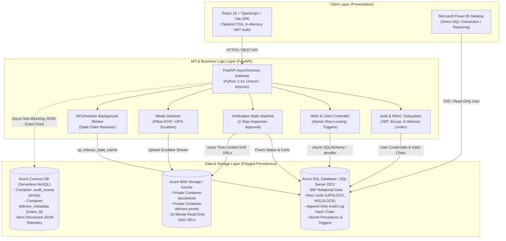

# 3. System Architecture

## 3.1 Architecture Overview
WishWell is built using a modern, multi-tier polyglot persistence architecture designed for high integrity, strong privacy, and minimal cloud operational costs.

---

## 3.2 Component Breakdown

### 1. Client Layer (Frontend SPA)
- **Technology**: React 18, Vite, TypeScript, Tailwind CSS, Recharts.
- **Role**: Delivers a mobile-first, responsive user interface with warm, calm styling (avoiding standard corporate charity clichés).
- **Security Design**:
  - Keeps JWT authentication tokens strictly in JavaScript memory (via React Context), completely avoiding `localStorage` where XSS attacks can steal tokens.
  - Role-protected routes ensure unauthorized users cannot render restricted views.

### 2. Application Layer (FastAPI Backend)
- **Technology**: Python 3.14 / 3.11, FastAPI, Uvicorn, Pydantic v2.
- **Asynchronous Execution**: Fully non-blocking I/O using Python `async`/`await` across all database and storage requests.
- **Domain Controllers**:
  - **Auth**: Passlib bcrypt password verification, JWT minting and decoding.
  - **Wishes & Claims**: Atomic transaction coordinator using SQLAlchemy 2.0 `with_for_update()`.
  - **Verifications**: Two-step workflow engine requiring physical inspector notes before admin approval.
  - **Media Pipeline**: Pillow-based file sanitizer that strips all EXIF tags, GPS metadata, and re-encodes images to JPEG/PNG.
  - **Scheduler**: APScheduler runs every 30 minutes executing `dbo.sp_release_stale_claims` to recycle abandoned claims.

### 3. Relational Database Layer (Microsoft SQL Server / Azure SQL)
- **Technology**: Microsoft SQL Server 2022 Developer / Azure SQL Database Serverless.
- **Role**: Primary System of Record for structured, relational, highly consistent transactional data.
- **Design Highlights**:
  - Strict Third Normal Form (3NF) eliminating redundancy.
  - Row-level lock hints (`UPDLOCK`, `ROWLOCK`) prevent race conditions during item claiming.
  - Append-only cryptographic hash chain on `dbo.audit_log`.
  - Server-side stored procedures and triggers enforce business rules even if accessed directly via SQL.

### 4. Binary Storage Layer (Azure Blob Storage)
- **Technology**: Azure Blob Storage (Azurite Emulator in development).
- **Role**: Stores raw binary files (identity certificates, NGO registration licenses, item delivery proof photos).
- **Zero Public Access**: Containers are marked `PRIVATE`. All file reads require short-lived (15-minute) Shared Access Signature (SAS) URLs generated on the server with read-only permissions (`r`).

### 5. Semi-Structured NoSQL Layer (Azure Cosmos DB)
- **Technology**: Azure Cosmos DB (Core/SQL API, Serverless tier).
- **Role**: Polyglot persistence for semi-structured, extensible JSON documents:
  - Container `audit_events` (Partition Key: `/entity`): Stores full request context, headers, client IP, and deep event diffs.
  - Container `delivery_metadata` (Partition Key: `/claim_id`): Stores courier tracking webhooks, delivery events, and recipient feedback.
- **Resilience Design**: If Cosmos DB is temporarily unreachable, the relational SQL transaction still succeeds, logging a warning and falling back gracefully without disrupting user workflows.

### 6. Analytics & Business Intelligence Layer (Power BI)
- **Technology**: Microsoft Power BI Desktop.
- **Role**: Executive reporting connected directly to Azure SQL using a dedicated read-only database user (`pbi_reader`).
- **Pre-Aggregated Views**: Consumes SQL views (`vw_wishes_by_category_month`, `vw_avg_delivery_time`, `vw_institutions_by_status`, `vw_stale_claim_rate`, `vw_top_categories`) for sub-second visual rendering.

---

## 3.3 Verification & Screenshots Checklist
- [TODO: Screenshot Azure Resource Group showing App Service, Azure SQL Database, Storage Account, Key Vault, and Cosmos DB]
- [TODO: Screenshot Azure App Service Configuration tab showing Key Vault references]
- [TODO: Screenshot Swagger UI at `http://localhost:8000/docs` showing API route grouping]

