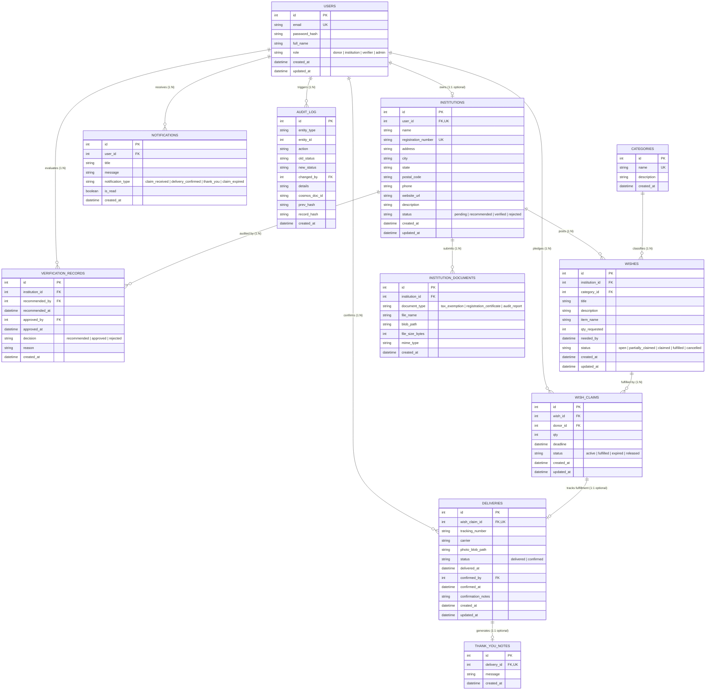

# 6. Entity-Relationship Model & 3NF Normalization

## 6.1 Entity-Relationship (ER) Diagram

The WishWell relational schema consists of 10 structured entities designed to support the entire wish-fulfillment, two-step verification, delivery tracking, and cryptographic audit lifecycle.



---

## 6.2 Formal Third Normal Form (3NF) Normalization Justification

Database normalization prevents data redundancy, eliminates update/delete anomalies, and guarantees mathematical integrity.

### 1. First Normal Form (1NF)
- **Requirement**: All attributes must be atomic (no arrays, repeating groups, or compound values), and each table must have a unique Primary Key.
- **WishWell Implementation**:
  - Every column holds indivisible scalar values (`INT`, `NVARCHAR`, `DATETIME2`).
  - No comma-separated lists of items or documents are stored. Multiple claims on a single wish are decomposed into individual rows in `dbo.wish_claims`. Multiple certificates are stored as separate rows in `dbo.institution_documents`.
  - Every table defines a surrogate primary key `id INT IDENTITY(1,1)`.

### 2. Second Normal Form (2NF)
- **Requirement**: Must be in 1NF, and no non-prime attribute may depend on only a subset of any candidate key (no partial functional dependencies).
- **WishWell Implementation**:
  - Every table in WishWell uses a single-column primary key (`id`).
  - Because no primary key consists of multiple columns (no composite primary keys), **partial dependency is mathematically impossible**. Every non-key column automatically depends on the entire candidate key (`id`).

### 3. Third Normal Form (3NF)
- **Requirement**: Must be in 2NF, and no non-prime attribute may transitively depend on the primary key ($X \to Y$ and $Y \to Z$ where $X$ is a candidate key and $Z$ is non-prime). In colloquial terms: **"Every non-key attribute must depend on the key, the whole key, and nothing but the key."**

### Table-by-Table 3NF Analysis:

#### A. `users` Table
- **Candidate Keys**: `{id}`, `{email}`
- **Functional Dependencies**: `id -> email, password_hash, full_name, role, created_at, updated_at`
- **3NF Proof**: Contains solely authentication and identity fields. Institution-specific attributes (such as registration numbers or facility addresses) are deliberately not stored here. Storing them here would force donors to have NULL values and introduce transitive dependencies.

#### B. `institutions` Table
- **Candidate Keys**: `{id}`, `{user_id}`, `{registration_number}`
- **Functional Dependencies**: `id -> user_id, name, registration_number, address, city, state, postal_code, phone, website_url, description, status`
- **3NF Proof**: Separated from `users` in a 1:1 relationship. The facility's physical address and phone number depend solely on the institution entity.

#### C. `categories` Table
- **Candidate Keys**: `{id}`, `{name}`
- **Functional Dependencies**: `id -> name, description, created_at`
- **3NF Proof**: Decoupled from `wishes`. If category descriptions were stored inside `wishes`, every wish for "Bedding" would duplicate the category description text. Changing that description would cause an **update anomaly**. Extracting `categories` ensures zero duplication.

#### D. `wishes` Table
- **Candidate Keys**: `{id}`
- **Functional Dependencies**: `id -> institution_id, category_id, title, description, item_name, qty_requested, needed_by, status, created_at, updated_at`
- **3NF Proof**: Contains attributes inherent strictly to the wish itself.
  - Institution contact data is not duplicated (retrieved via `institution_id`).
  - Category descriptions are not duplicated (retrieved via `category_id`).
  - **No Denormalized Counters**: The remaining unclaimed quantity is NOT stored as a static column in `wishes`. Instead, the remaining quantity is computed on-the-fly via the database view `v_open_wishes` (`qty_requested - COALESCE(SUM(active claims), 0)`). This prevents **modification anomalies** where claim counts drift out of sync with actual claim records.

#### E. `wish_claims` Table
- **Candidate Keys**: `{id}`
- **Functional Dependencies**: `id -> wish_id, donor_id, qty, deadline, status, created_at, updated_at`
- **3NF Proof**: Associates a donor with a pledged quantity on a specific wish. The wish title, item name, and donor email are not duplicated here; they are accessed through foreign key joins.

#### F. `deliveries` Table
- **Candidate Keys**: `{id}`, `{wish_claim_id}`
- **Functional Dependencies**: `id -> wish_claim_id, tracking_number, carrier, photo_blob_path, status, delivered_at, confirmed_by, confirmed_at, confirmation_notes`
- **3NF Proof**: Separated from `wish_claims`. A claim represents the intention/pledge, whereas a delivery represents the physical shipment and photographic receipt proof.

#### G. `thank_you_notes` Table
- **Candidate Keys**: `{id}`, `{delivery_id}`
- **Functional Dependencies**: `id -> delivery_id, message, created_at`
- **3NF Proof**: Kept as a distinct entity linked to `delivery_id` (1:1). Storing message text inside `deliveries` would introduce empty columns for unconfirmed deliveries.

#### H. `audit_log` Table
- **Candidate Keys**: `{id}`
- **Functional Dependencies**: `id -> entity_type, entity_id, action, old_status, new_status, changed_by, details, cosmos_doc_id, prev_hash, record_hash, created_at`
- **3NF Proof**: Immutable append-only record storing the cryptographic state machine transitions.

---

## 6.3 Dynamic Calculation vs. Denormalization (The `v_open_wishes` View)
In textbook relational database theory, storing a calculated column (such as `qty_remaining`) violates 3NF because `qty_remaining` functionally depends on the aggregate of another table (`wish_claims`).

WishWell resolves this cleanly using the standard SQL view `dbo.v_open_wishes`:
```sql
CREATE OR ALTER VIEW dbo.v_open_wishes AS
SELECT 
    w.id,
    w.institution_id,
    w.category_id,
    w.title,
    w.item_name,
    w.qty_requested,
    w.needed_by,
    w.status,
    (w.qty_requested - COALESCE(SUM(CASE WHEN wc.status = 'active' THEN wc.qty ELSE 0 END), 0)) AS qty_remaining,
    i.name AS institution_name,
    i.city AS institution_city,
    i.state AS institution_state,
    c.name AS category_name
FROM dbo.wishes w
JOIN dbo.institutions i ON w.institution_id = i.id
JOIN dbo.categories c ON w.category_id = c.id
LEFT JOIN dbo.wish_claims wc ON w.id = wc.wish_id AND wc.status = 'active'
WHERE w.status IN ('open', 'partially_claimed')
GROUP BY 
    w.id, w.institution_id, w.category_id, w.title, w.item_name, 
    w.qty_requested, w.needed_by, w.status, i.name, i.city, i.state, c.name;
```
This guarantees that **remaining quantities can never become corrupt or desynchronized**, even if claims are cancelled, expire, or are released.

---

## 6.4 Verification & Screenshots Checklist
- [TODO: Open SQL Server Management Studio (SSMS) or Azure Data Studio and screenshot the `WishWell` database diagram showing all foreign key constraints]
- [TODO: Run `SELECT * FROM dbo.v_open_wishes` and screenshot the output showing `qty_remaining`]

